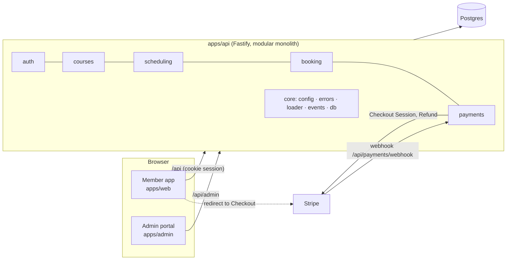
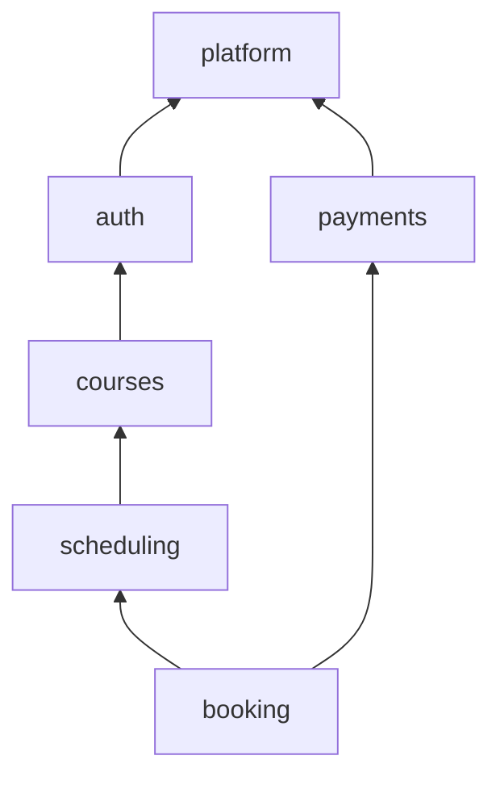
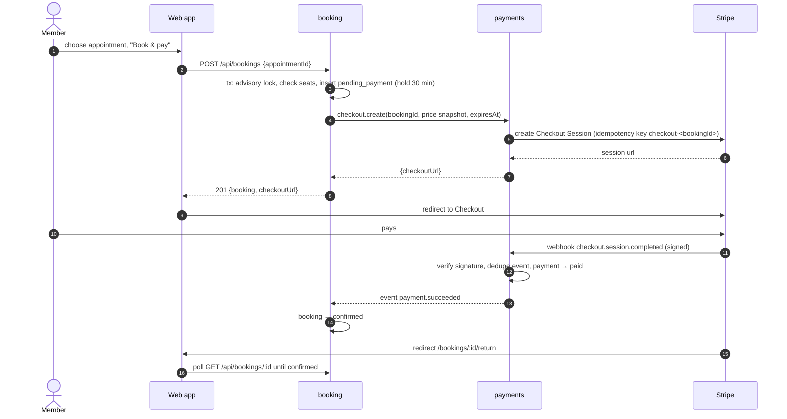

# Architecture

## Overview

- **Modular monolith.** One deployable API process. It is split into modules with
  explicit dependencies, which is cheap to run and easy to split later. Modules are the
  unit of ownership, of requirements, and of agent work.
- **Two frontends.** The member app and the admin portal are deployed separately, which
  keeps the admin surface small and makes it easy to restrict by network if needed.
  Both are SPAs that talk to the same API with cookie sessions.
- **Contracts package.** The zod schemas in `packages/contracts` are the single
  definition of the HTTP API. The API uses them to validate requests, and the
  frontends use them to parse responses.

## Module dependencies

Every module depends on `platform`, the core. When a module needs to talk "upwards",
it does not import. It uses:

- **Ports:** the lower module declares an interface, and the upper module implements
  it. Example: scheduling needs seat counts and declares `scheduling.occupancy`.
  Booking provides it.
- **Domain events:** example: payments publishes `payment.succeeded`, and booking
  subscribes.

## The book-and-pay flow

Key properties:

- **Capacity safety:** a transaction-scoped advisory lock per appointment makes the seat
  check and the insert atomic (BOOK-002).
- **Holds instead of overbooking:** a pending booking holds a seat for
  `BOOKING_HOLD_MINUTES` (≥ 30, the Stripe Checkout minimum). Expiry is enforced in
  three ways: in the seat count query, by a sweeper, and by the
  `checkout.session.expired` webhook.
- **The webhook is the source of truth.** The success redirect never confirms a
  booking (BOOK-006).
- **Idempotency everywhere:** Stripe idempotency keys, stored event ids, and monotonic
  state transitions (PAY-003).

## Tech stack

| Concern  | Choice                                                            | ADR  |
| -------- | ----------------------------------------------------------------- | ---- |
| Language | TypeScript (strict), Node 22                                      | 0001 |
| Monorepo | pnpm workspaces                                                   | 0001 |
| API      | Fastify 5, zod 4                                                  | 0001 |
| Database | Postgres 17, Drizzle ORM, drizzle-kit migrations. PGlite in tests | 0001 |
| Frontend | React 19, Vite, React Router                                      | 0001 |
| Tests    | Vitest (unit/integration), Testing Library, Playwright (e2e)      | 0001 |
| Payments | Stripe Checkout (hosted) and webhooks                             | 0004 |
| Auth     | Server-side sessions in an httpOnly cookie, argon2id              | 0005 |
