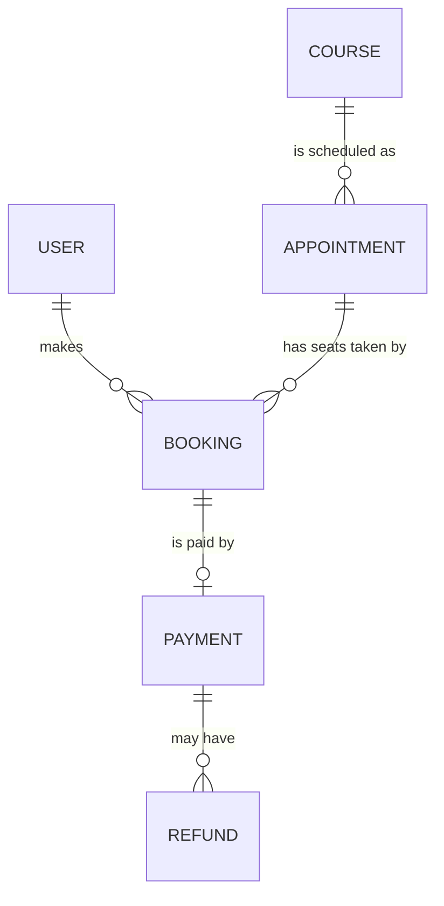
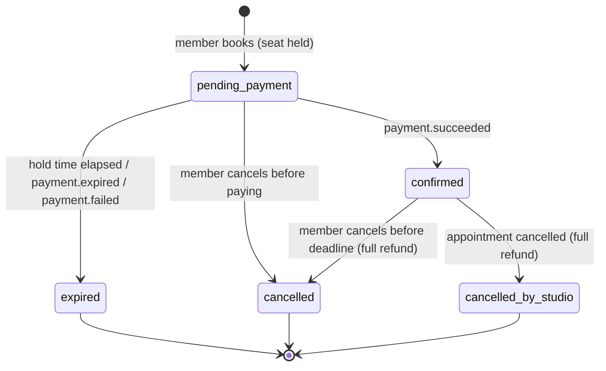
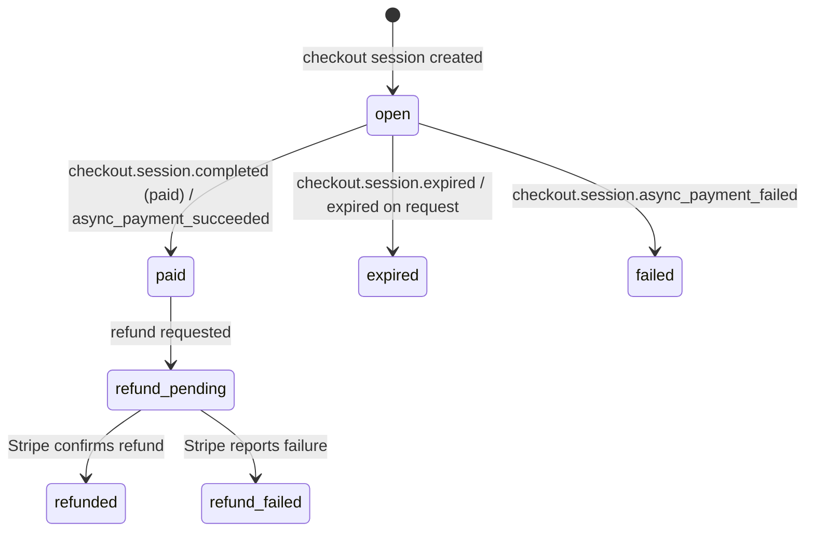

# Domain model

Each entity has exactly **one owning module**. Only the owner writes its tables. Other
modules read it through the owner's `interface.md` (services/ports) or react to its
domain events.

| Entity        | Owner        | Key fields                                                                                                                                       |
| ------------- | ------------ | ------------------------------------------------------------------------------------------------------------------------------------------------ |
| `User`        | `auth`       | `id`, `email` (unique, lower-cased), `name`, `role` (`member` \| `admin`), `passwordHash`, `createdAt`                                           |
| `AuthSession` | `auth`       | `id` (opaque random), `userId`, `expiresAt`, `lastSeenAt`                                                                                        |
| `Course`      | `courses`    | `id`, `title`, `description`, `level`, `durationMinutes`, `defaultCapacity`, `defaultPriceCents`, `status` (`active` \| `archived`)              |
| `Appointment` | `scheduling` | `id`, `courseId`, `startsAt`, `endsAt`, `capacity`, `priceCents`, `location`, `instructor`, `status` (`scheduled` \| `cancelled`), `seriesId?`   |
| `Booking`     | `booking`    | `id`, `userId`, `appointmentId`, `status`, `priceCents` (snapshot), `currency`, `holdExpiresAt`, `confirmedAt?`, `cancelledAt?`, `cancelReason?` |
| `Payment`     | `payments`   | `id`, `bookingId`, `stripeCheckoutSessionId`, `stripePaymentIntentId?`, `amountCents`, `currency`, `status`, `refundStatus`                      |
| `StripeEvent` | `payments`   | `id` (Stripe event id), `type`, `processedAt` (used for idempotency)                                                                             |

IDs are UUIDs (v7 preferred) generated by the API. All timestamps are stored in UTC.
Money is stored as integer minor units (`priceCents`) plus an ISO currency code.

## Booking lifecycle (owned by `booking`)

- A seat is **taken** by `confirmed` bookings and by `pending_payment` bookings whose
  `holdExpiresAt` is in the future.
- **Late payment:** a `payment.succeeded` for an `expired` booking confirms it if a seat
  is still free. Otherwise the booking stays `expired` and a full refund is requested
  (`BOOK-006`).
- Terminal states never change again.

## Payment lifecycle (owned by `payments`)

## Appointment lifecycle (owned by `scheduling`)

`scheduled` → `cancelled` (by an admin, terminal). An appointment whose `startsAt` is in
the past is "past" (derived, not stored) and is not bookable.
